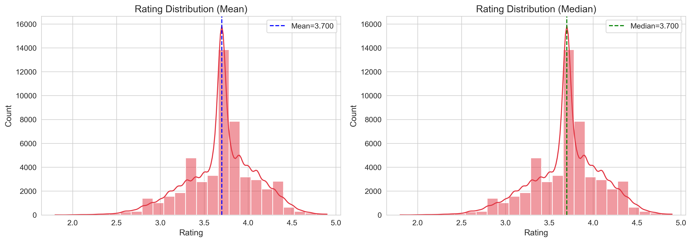
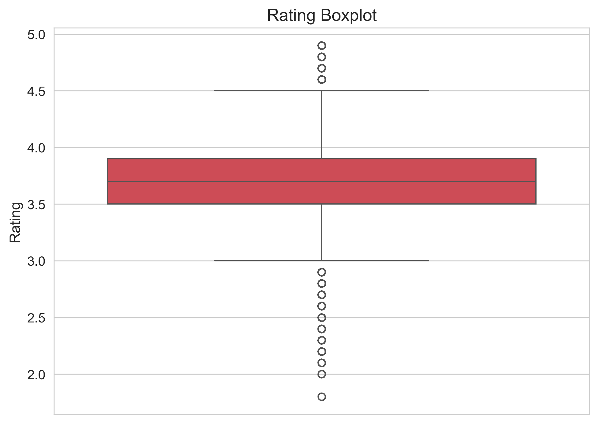
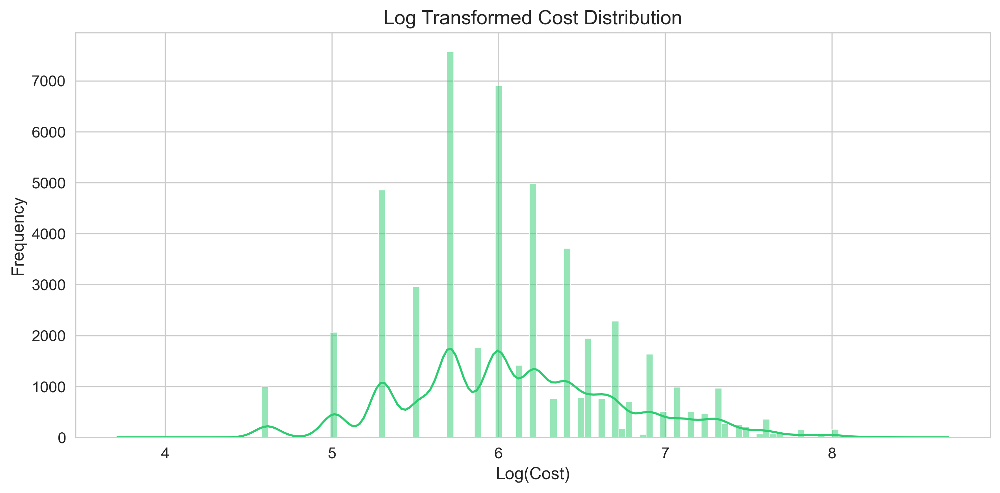
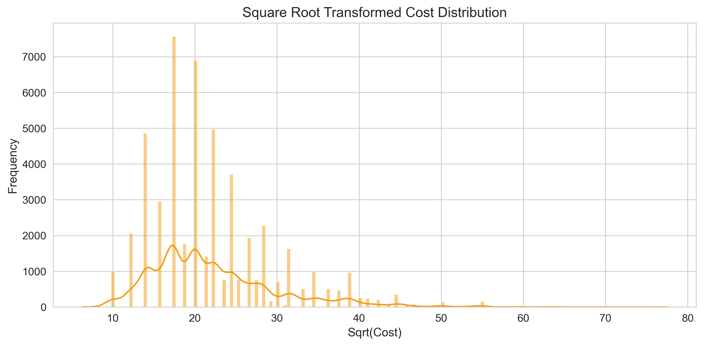
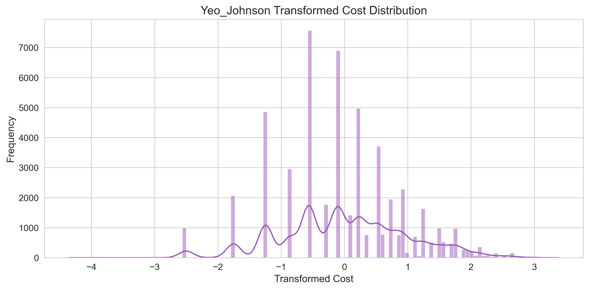
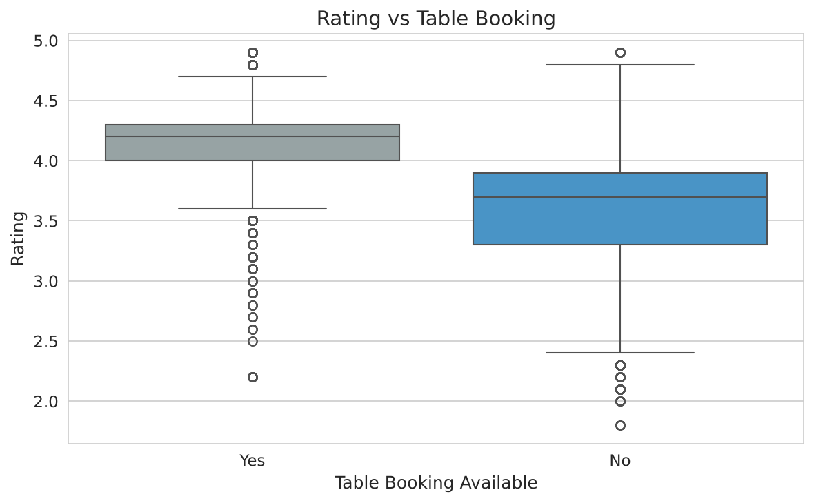
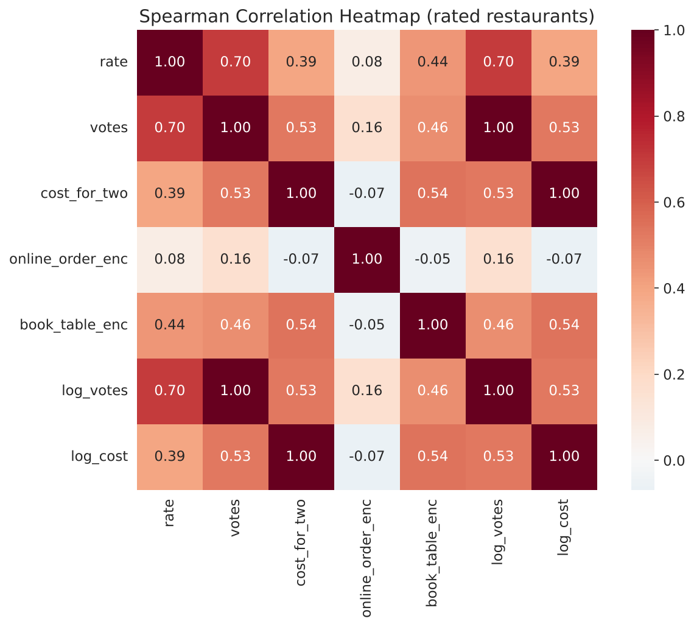
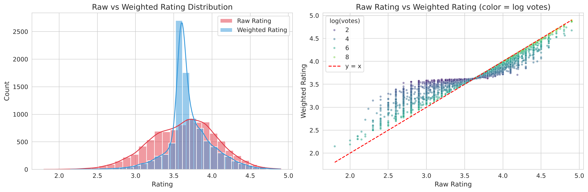
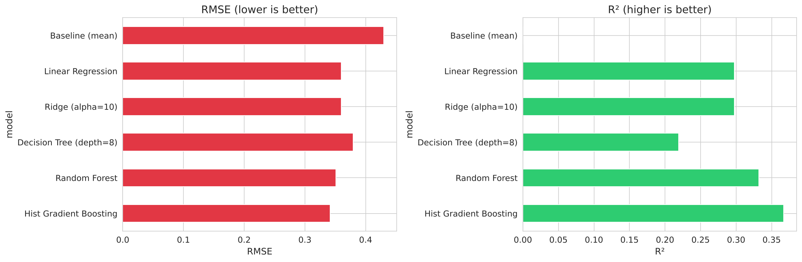
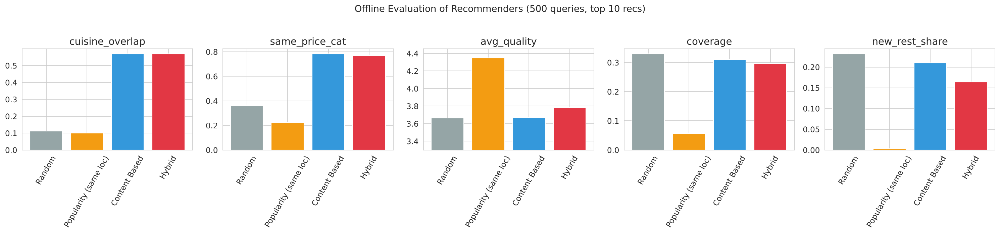

# zomato-eda
Exploratory Data Analysis + Restaurant Recommendation System on Zomato (Bangalore) restaurant dataset using Python, Pandas ,Matplotlib , Seaborn and scikit-learn

## Project Status :-)
- [x] Data Cleaning & Preprocessing
- [x] Univariate Analysis
- [x] Bivariate/Multivariate Analysis
- [x] Feature Engineering (restaurant level data, weighted rating, multi-hot, tags)
- [x] Rating Prediction Models (for NEW / unrated restaurants)
- [x] Recommendation System (popularity, content based, hybrid, preference based)
- [x] Insights and Conclusions

## Notebooks (run in this order)

| # | Notebook | What it does | Output |
|---|---|---|---|
| 1 | `Zomato_EDA.ipynb` | Cleaning, preprocessing, univariate analysis of rate & cost | `zomato_cleaned.csv` |
| 2 | `02_Zomato_EDA_Bivariate_Multivariate.ipynb` | Remaining univariate (votes + categorical), bivariate & multivariate analysis, stats tests | plots |
| 3 | `03_Feature_Engineering.ipynb` | Fix broken names, unrated restaurants, 1 row per restaurant, weighted rating (IMDB formula), multi-hot, `tags` | `restaurants_processed.csv` |
| 4 | `04_Rating_Prediction_Models.ipynb` | Baseline, Linear/Ridge, Decision Tree, Random Forest, Gradient Boosting + CV & tuning -> predict rating for NEW restaurants (cold start) | `restaurants_final.csv` |
| 5 | `05_Recommendation_System.ipynb` | Popularity, Content based (TF-IDF + cosine), Hybrid, Preference based search + offline evaluation | - |

> Notebooks 2-5 only need `zomato_cleaned.csv` (already in repo), so you don't need the 500mb raw file for them.

### Key results
- Same restaurant is repeated ~4 times in raw data -> 51,632 rows become **12,463 unique restaurants**.
- ~24% restaurants are unrated (NEW) -> their rating is predicted with a ML model.
- Best rating model : **Hist Gradient Boosting** -> test RMSE 0.341, R² 0.37 (baseline RMSE 0.430), without using votes.
- **Hybrid recommender** (0.7 x similarity + 0.3 x quality) keeps the relevance of content based (cuisine overlap 0.57)
  while giving better rated recommendations (avg quality 3.67 -> 3.78).

## Dataset Used : 

You can download it from Kaggle (link added): [Zomato Bangalore Restaurants](https://www.kaggle.com/datasets/himanshupoddar/zomato-bangalore-restaurants)

## What is covered till now : 
- Removed the irrelevant text columns ( Some related to NLP and stuff )
- Fixed inconsistent `rate` and `approx_cost` columns
- Text standardization (whitespace removal, title casing)
- Null value handling (median fill, Unknown fill, dropped, high-null cols)
- Binary encoding (`online_order` , `book_table` -> 0/1)
- Feature engineering: `price_category` , `rating_category` (binning)
- Univariate analysis on `rate` and `cost_for_two`
    - Distribution plots, skewness, kurtosis, outlier detection
    - Compared Log1p, Sqrt, Yeo-Johnson transformation to fix right skewed cost data
  

> Also I added descriptions of steps in notebook file ( you can read for better understanding)

## Tools used
Pandas, Numpy, Matplotlib ,Seaborn, SciPy, Scikit-learn.

## To run this notebook 
1. Just download the dataset `.csv` file from kaggle (about 500+ mb size)
2. Place that `zomato.csv` in same folder where u kept the notebook
3. Run it .

## Output Files
- `zomato_cleaned.csv` : Cleaned dataset generated after preprocessing (9MB)
  - 51632 rows, 12 columns, 0 nulls
- `restaurants_processed.csv` : restaurant level dataset with engineered features (12463 rows)
- `restaurants_final.csv` : above + `predicted_rate` for NEW restaurants + final `quality_score` used by the recommender

## Sample Visualizations

### 1. Rating Distribution (Mean vs Median)

------

### 2. Rating Boxplot 

Boxplot for detecting the potential outliers.

------- 

### 3. Log Transformation

Log1p transformation reduces skewness significantly.

----------

### 4. Sqrt Transformation

This is gentle squashing transformation , it is stronger than doing nothing but weaker than log transform.

------------

### 5. Yeo-Johnson Transformation

Power transformation applied to improve normality.

------------

### 6. Rating vs Table Booking (Bivariate)

------------

### 7. Correlation Heatmap

------------

### 8. Raw vs Weighted Rating

Restaurants with few votes get pulled towards the global mean.

------------

### 9. Rating Prediction : Model Comparison

------------

### 10. Recommender Evaluation

